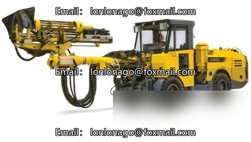
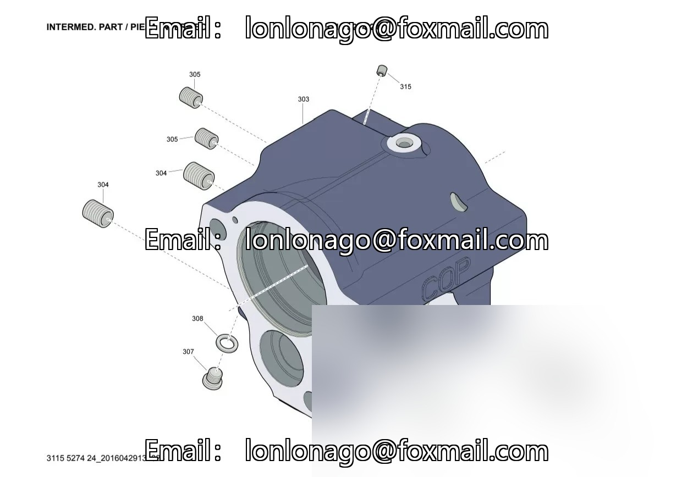
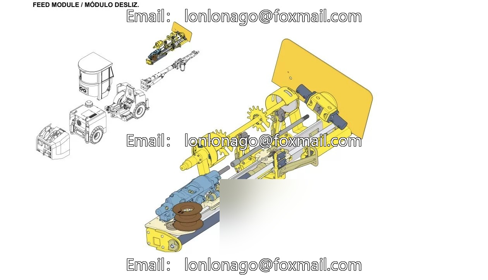
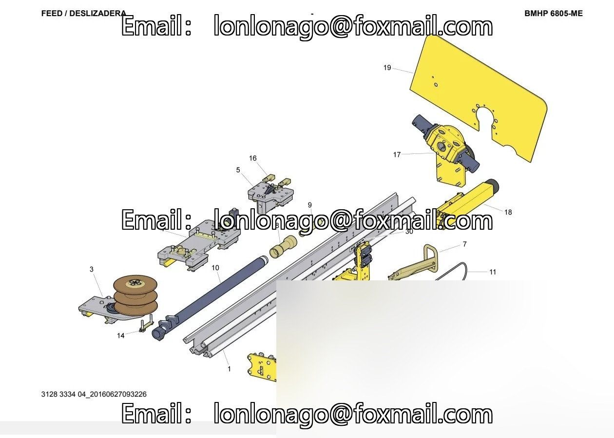
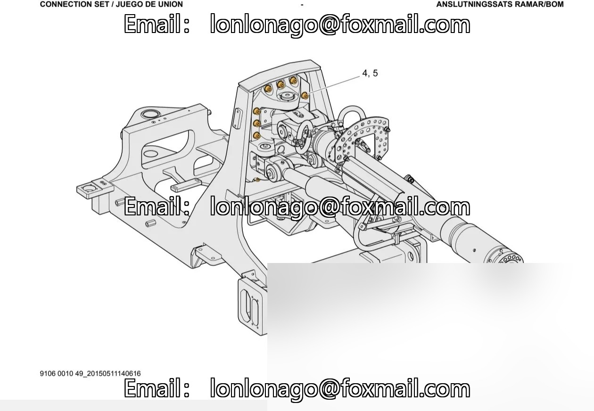
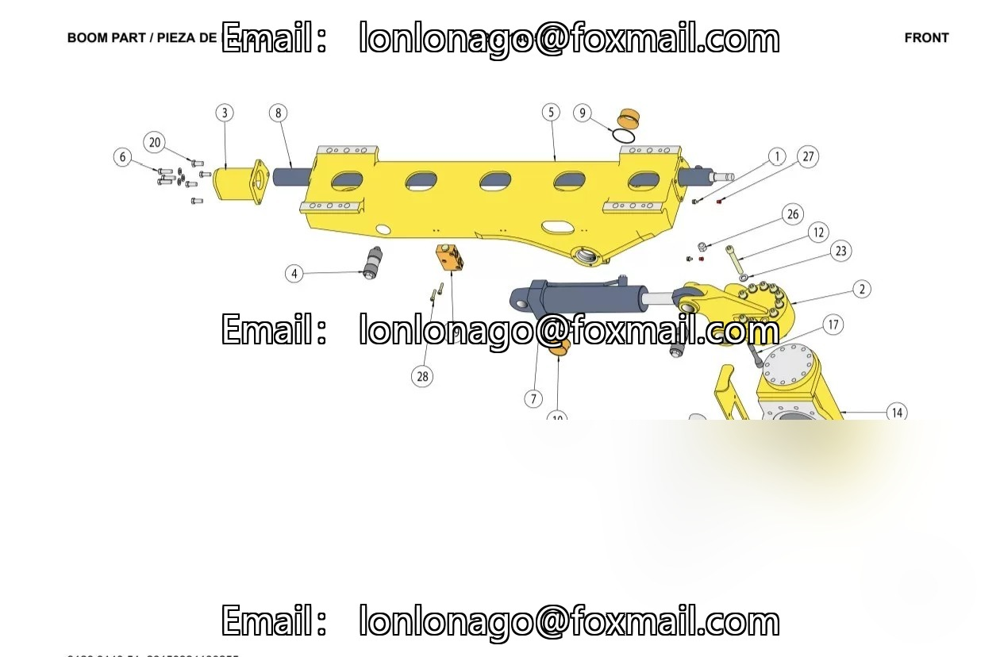

# Atlas Copco Simba S7

## Body

Atlas Copco Simba S7 D deep-hole drilling rig parts catalog
PDF , 1,300 pages, comprehensive content, suitable for repair and parts inquiry.
34-899
Equipment name: Atlas Copco Simba S7 D

Equipment type: Medium-deep hole drilling rig (trailer type)

Primary usage: specifically used for blasting hole drilling operations in underground mines or tunnels. It can drill parallel deep holes in both upward and downward directions, so as to perform subsequent charge blasting.

Key performance: Typically equipped with hydraulic hammer drilling machine, drilling diameter range generally between 51mm - 89mm, maximum drilling depth can reach over 20 meters.

The catalog covers spare parts for a medium-deep hole rock breaking trolley, with 1300-page content that is complete and suitable for maintenance and part lookup; identifiers such as 34-899 and specific parts are listed.

<!-- AI_ENRICHED -->

## Images

## Payment

Here is a pay link on Stripe ( https://buy.stripe.com/3cs8yP7sY87d0vu9AB ). Please contact me lonlonago@foxmail.com after funding $89, and I will send you a complete data files , thank you!

